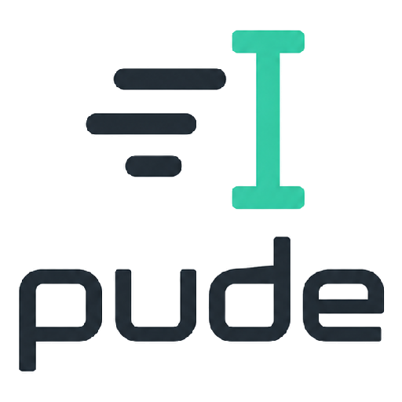
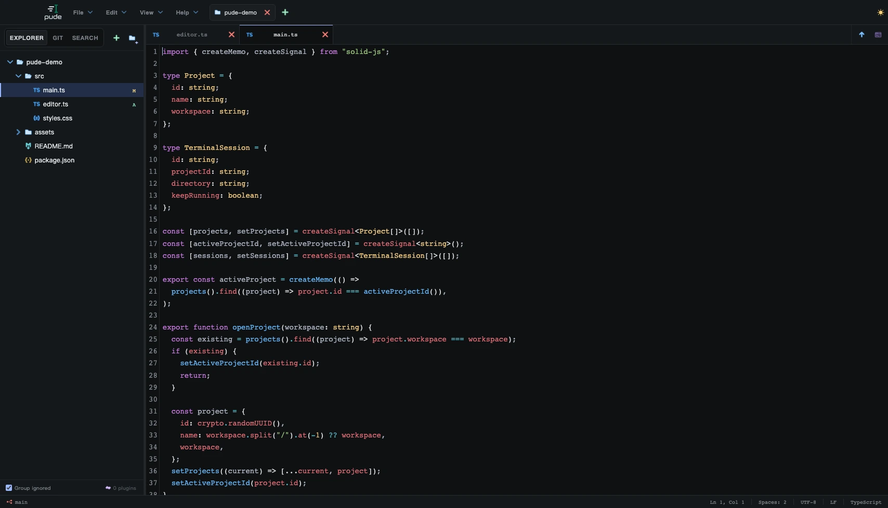

<p align="center">
  
</p>

<h1 align="center">pude</h1>

<p align="center">
  <strong>pure code editor</strong> — a fast, local-first desktop code editor for focused work.
</p>

<p align="center">
  <a href="https://github.com/MajajaX/pude/releases/latest">Download</a> ·
  <a href="docs/plugin-api-v2.md">Plugin API</a> ·
  <a href="docs/product-spec.md">Product spec</a> ·
  <a href="CONTRIBUTING.md">Contributing</a> ·
  <a href="CHANGELOG.md">Changelog</a>
</p>

<p align="center">
  <a href="LICENSE"></a>
  
  
</p>



## Why pude

pude opens a folder and gets out of your way. It starts fast, stays light and keeps
everything on your machine: no account, no cloud sync, no telemetry and no background
indexing. Features load only when you use them.

## pude vs VS Code

Measured side by side with Visual Studio Code on the same Mac, opening the same folder.

| | pude 0.1.2 | VS Code 1.140.0 | |
| --- | ---: | ---: | --- |
| Installer download · macOS Apple Silicon | 5.1 MB | 317.9 MB | 62× smaller |
| Installer download · Windows x64 | 3.9 MB | 244.4 MB | 63× smaller |
| Size on disk (macOS) | 10.5 MB | 911.6 MB | 87× smaller |
| Launch until ready | 0.60 s | 1.11 s | 1.8× faster |
| Memory with a folder open | 103 MB | 1,074 MB | 10× less |
| Processes with a folder open | 6 | 12 | |

Measured on 2026-10-15 on an Apple M5 Max with 64 GB of memory and macOS 27.0.1.
Both editors open this repository; VS Code uses a fresh profile with no extensions
added. Installer sizes are the official downloads. Launch time runs from launch until
the window stops changing, and memory is the physical footprint of the app and all
of its helper processes 15 seconds after launch, each the median of 7 runs. Quit
pude, then reproduce the launch and memory numbers on your Mac with
`node scripts/benchmark/compare-vscode.mjs` (the terminal needs the Screen Recording
permission).

These numbers were measured with pude 0.1.2. Later releases are larger: the 0.1.7
installers are 5.6 MB (macOS) and 4.3 MB (Windows), per the GitHub release assets.
Launch time, memory and size on disk have not been re-measured since 0.1.2.

## Features

- **Project tabs** — open several folders in one window. Each project keeps its own
  files, unsaved edits, undo history, Git view and terminals.
- **Workspaces** — show several folders in one project tab with **File > Add folder
  to workspace…**, and save them as a `.pdw` workspace file to reopen later. A new tab
  lists recent folders and recent workspaces separately; right-click pude in the
  macOS Dock or the Windows taskbar for a new window or a recent item, which opens as
  a new tab in the window you used last.
- **Editor** — CodeMirror 6 with syntax highlighting including `.env` / `.env.*`, find and
  replace with a match count, bracket matching, auto-closing brackets, code folding,
  multiple selections, pinned tabs, Save As and a wide, readable Markdown
  source/preview toggle. Optional trim-trailing-whitespace and final-newline on save.
  `.env` files also open as a table of names and values with copy buttons for a name,
  a value or a whole line.
- **Command palette** — `⌘⇧P` / `Ctrl+Shift+P` lists 40+ commands with their shortcuts,
  such as sort lines, change case, toggle word wrap and go to file (`⌘P` / `Ctrl+P`),
  with recently used commands first.
- **Readable interface** — bundled open-source Inter and JetBrains Mono fonts,
  larger interface text and high-contrast labels in both dark and light themes, in
  English or Traditional Chinese (**Settings > Language**, follows the system by
  default).
- **Explorer and project search** — **EXPLORER / GIT / SEARCH** sidebar tabs,
  optional Git-ignored grouping, file operations and on-demand text or file-path
  search with `⌘⇧F` / `Ctrl+Shift+F`. Search reads saved files, respects Git ignores
  by default and supports match case. Text results center and highlight the match.
  Replace changes every match in the project or in one file, skipping files with
  unsaved edits.
- **Safe saves** — atomic writes, preserved LF/CRLF line endings, external change
  detection and crash recovery for unsaved work.
- **Git** — status, staging, commits, branches, stash, push/pull, a commit graph that
  loads older commits as you scroll and refreshes after every Git change, a stash list
  with apply, pop, drop and diffs, and full-file diffs, using the Git already
  installed on your system.
- **Terminals** — multiple on-demand terminal sessions per project that keep running
  while you switch projects. Right-click a file or folder in Explorer and choose
  **Open in Integrated Terminal** to start a new tab in that folder or the file's
  parent directory. Drag the panel's top edge to resize it; the height is remembered.
  Ctrl+C interrupts the running program, such as a dev server, and returns to the
  prompt in the same shell, as in the operating system's own terminal. Windows uses
  PowerShell 7 when installed, otherwise Windows PowerShell. A project's Python
  virtual environment (`.venv`, `venv` or `env`) is not activated automatically, since
  a cloned repository could put its own executables first on `PATH`: the terminal
  says it found one, and **Terminal: Trust Python Environment** in the command
  palette activates it for that folder from then on.
- **Plugins** — install local plugins with permission review. See the
  [Plugin API 2 guide](docs/plugin-api-v2.md) and the
  [examples](examples/plugins).

pude deliberately leaves out project-wide indexing, a debugger, AI services, a plugin
marketplace and silent automatic updates.

## Install

Download the installer for your platform from
[GitHub Releases](https://github.com/MajajaX/pude/releases/latest):

| Platform | File |
| --- | --- |
| macOS 14+ (Apple Silicon) | [`pude-macos-arm64.dmg`](https://github.com/MajajaX/pude/releases/latest/download/pude-macos-arm64.dmg) |
| Windows 11 x64 | [`pude-windows-x64-setup.exe`](https://github.com/MajajaX/pude/releases/latest/download/pude-windows-x64-setup.exe) (unsigned) |

Each release includes `SHA256SUMS.txt` so you can verify your download. pude never
installs an update by itself. When an update is available, click **Update [version]**
beside the branch name at the lower left to download it, then **Restart and update**.
The About dialog also provides update controls and release notes, or install the
newer version manually.
Linux builds are planned — until then you can [build from source](#build-from-source).

The [website download section](https://pude.dev/#download) recommends an installer
using the OS, version and CPU details your browser provides. If those details are
hidden, confirm the system requirements before installing. Both platform downloads
are always available manually; Intel Macs, Windows ARM and mobile devices have no
native installer in this release.

## Build from source

You need [Node.js](https://nodejs.org/) 22.12+ (24 recommended) with npm 10.9+,
[Rust](https://rustup.rs/) stable, Git on your `PATH`, and the
[Tauri prerequisites](https://v2.tauri.app/start/prerequisites/) for your OS.

```bash
git clone https://github.com/MajajaX/pude.git
cd pude
npm ci
npm run tauri:dev
```

| Command | What it does |
| --- | --- |
| `npm run tauri:dev` | Run the desktop app in development mode |
| `npm run tauri:build` | Build an installer for the current platform |
| `npm run dev` | Run the UI in a browser with an in-memory demo workspace |
| `npm run web:dev` | Run the project website |
| `npm run check` | Run tests, type checks and production builds |

See [CONTRIBUTING.md](CONTRIBUTING.md) for platform notes and the full workflow.

## Project layout

```text
apps/desktop/src/          SolidJS UI, editor and frontend logic
apps/desktop/src-tauri/    Rust backend: filesystem, Git, terminal, plugins
apps/web/                  Project website
examples/plugins/          Example plugins
docs/                      Product specification, plugin API and release guides
scripts/                   Build and release tooling
```

## Privacy and security

Your files stay where they are. Settings, sessions and recovery data are stored
locally. pude itself only goes online to look for updates: once shortly after startup
(turn it off in Settings) and when you click **Check for updates** in the About
dialog. Updates are downloaded from GitHub Releases, verified against a signature, and
installed only after you choose **Restart and update**. Git, terminal commands and
plugins you grant network access can reach the network on their own.

The terminal and plugins run with your user account's permissions, so install only
plugins you trust. Please report vulnerabilities privately as described in
[SECURITY.md](SECURITY.md).

## Contributing

Bug reports, ideas and pull requests are welcome. Read
[CONTRIBUTING.md](CONTRIBUTING.md) before you start.

## License

pude is released under the [MIT License](LICENSE). Third-party licenses are listed in
[THIRD_PARTY_NOTICES.md](THIRD_PARTY_NOTICES.md) and
[THIRD_PARTY_LICENSES.md](THIRD_PARTY_LICENSES.md).
