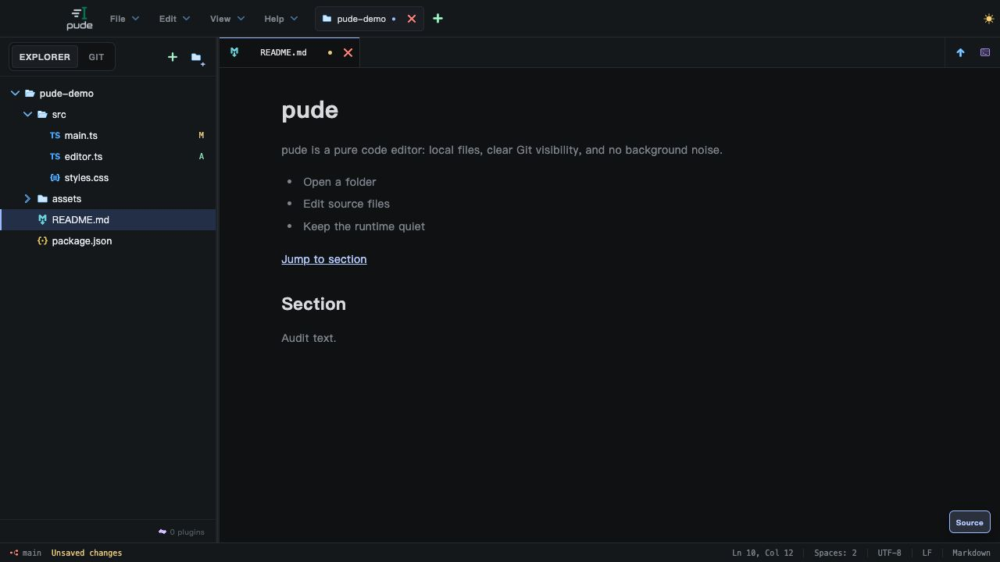

# pude 專案檢查報告

- 檢查日期：2026-10-15（Asia/Taipei）
- 檢查版本：`0.1.2`
- 程式基準：`ee32cfd87b6b5828a43eae19992e5f74f47fb395`

本次檢查桌面編輯器、Rust 原生後端、官網、測試與發佈工具，採用程式碼審查、既有測試、臨時重現案例及瀏覽器操作驗證。只新增這份報告與畫面證據，沒有修改產品程式或相依套件。

## 1. 整體判斷

專案的建置與主要測試基礎良好；檔案儲存、復原、背景讀取取消、外掛與終端機都有相當多的防護與單元測試。本次沒有確認到必然造成資料毀損或阻止整個產品運作的 P0／P1 問題，但仍找到 **13 項功能、工具或文件問題**，另有 **4 項維護與驗證風險**。

優先處理：

1. Terminal／LSP 停止失敗後遺失可重試的 session 狀態。
2. Git 側欄歷史漏接分頁，以及分支篩選殘留造成空白歷史。
3. 發佈版本驗證、prerelease 流程與更新說明不一致。

優先級定義：**P1** 為高影響、應立即修正；**P2** 為有明確條件的功能缺陷，建議近期處理；**P3** 為較低影響、少見輸入或尚未啟用路徑的瑕疵。測試未涵蓋某流程不等於該流程已經有 bug，以下會分開列出。

## 2. 實際驗證結果

環境：macOS、本機 Node.js `26.8.2`、npm `11.19.1`、Rust `1.98.1`、Cargo `1.98.1`。本機沒有執行 Windows／Linux 原生驗證。

| 檢查 | 結果 | 說明 |
| --- | --- | --- |
| `npm run check` | 通過 | 包含版本一致性、桌面測試與建置、bundle 預算、官網測試與型別檢查、官網建置。 |
| 桌面 Vitest | 630／630 通過 | 79 個測試檔；使用 Node 環境，不能視為完整 UI 測試。 |
| Bundle 預算測試 | 2／2 通過 | 實際桌面產物也符合設定的大小上限。 |
| 官網測試 | 10／10 通過 | 作業系統與下載選擇邏輯。 |
| 官網預先渲染 | 通過 | 4 個英文／繁中頁面驗證成功。 |
| `npm run release:tooling:self-test` | 7 項通過 | Rust runner、checksum、collector、update manifest、GitHub API fixture、notice gate、版本工具。 |
| Rust 測試 runner | 293 個有效測試最終通過；4 忽略 | 首次結果為 291 通過、2 失敗、4 忽略；兩個失敗測試解除沙箱限制後各自重跑通過，詳見下文。 |
| `cargo fmt ... -- --check` | 未通過 | 8 個 Rust 檔案、31 處格式差異。 |
| `cargo clippy ... --all-targets -- -D warnings` | 未通過 | bin target 回報 55 個錯誤、test target 回報 62 個；兩者有重疊，不應相加當成獨立缺陷數。 |
| `npm audit --json` | 通過 | 此次查詢回報 0 項已知公告；不代表程式邏輯或 Rust 套件沒有安全風險。 |
| Rust 套件公告 | 未執行 | 環境未安裝 `cargo-audit`，本次沒有另外安裝。 |
| 瀏覽器 demo 操作 | 基本流程通過 | 開啟檔案、搜尋、編輯與 Undo、切換檔案、Markdown 預覽、關閉最後一個專案後重新開檔。另重現 F10。 |

Rust 首次失敗的兩個測試是：

- `platform_trash::macos_trash_tests::foundation_trash_moves_disposable_volume_items_without_touching_user_trash`：沙箱內 `hdiutil` 無法建立測試映像；解除限制後通過。
- `watcher::watcher_tests::native_fsevents_overflow_and_root_recreation_recover_through_the_watcher_loop`：沙箱內收不到 FSEvents callback；解除限制後通過。

因此這兩次失敗歸類為**執行環境限制**。沒有宣稱第一次完整 Rust 命令成功，也沒有把它們列為產品缺陷。

瀏覽器以 `127.0.0.1:5173` 與獨立來源 `127.0.0.1:5187` 的記憶體 demo 驗證。前者在開發伺服器 HMR 後出現 session 復原診斷 `session.failure`，原因未定位；在獨立來源完成的流程未出現 warning／error。這個開發環境觀察未列為已確認產品缺陷。原生對話框、真實 PTY、實際安裝與更新仍不能由這些操作代替驗證。

## 3. 問題清單

| 編號 | 優先級 | 問題 | 證據類型 |
| --- | --- | --- | --- |
| F01 | P2 | Terminal 停止失敗後，前端遺失原 session ID | 實際 TS 原始碼編譯後的失敗注入案例＋後端路徑 |
| F02 | P2 | LSP 清理未成功時，manager 遺失可重試 handle | 靜態控制流程；未重現存活的孤兒程序 |
| F03 | P2 | Git 側欄歷史無法載入下一頁 | 元件 props 接線核對 |
| F04 | P2 | Git History 保留不存在的分支篩選 | 元件狀態與專案切換流程核對 |
| F05 | P2 | Windows 選用驗證器寫死版本，且文件遺漏執行限制 | 驗證條件與目前版本核對 |
| F06 | P2 | Prerelease 發布成功後會被自己的驗證器拒絕 | workflow 與驗證規則；臨時副本版本驗證 |
| F07 | P2 | 官網顯示版本與下載版本可不一致 | 使用舊 release URL 的實際建置 |
| F08 | P2 | 更新與隱私說明和程式行為不一致 | 英文／繁中文件與啟動邏輯核對 |
| F09 | P2 | 更新 manifest 接受不合法版本字串 | 臨時 fixture 實際執行 |
| F10 | P3 | Markdown 文件內錨點無法對應到標題 | 瀏覽器 DOM 驗證 |
| F11 | P3 | Demo 儲存把字串長度當成檔案 byte size | 讀寫流程與字元編碼核對；只影響 demo |
| F12 | P3 | Explorer retry 的備援判斷會呼叫兩個 callback | 明確的 `void`／`??` 邏輯；目前 App 未啟用 |
| F13 | P3 | Git 輸出分隔方式無法處理部分合法控制字元 | 真實 Git fixture＋相同 parser 邏輯 |

### F01：Terminal 停止失敗後遺失 session ID

位置：[terminal-lifecycle.ts](../apps/desktop/src/lib/terminal-lifecycle.ts) 第 13–29、43–47 行；[terminal.rs](../apps/desktop/src-tauri/src/terminal.rs) 第 3079–3092 行。

`stopActiveSession()` 在 `await backend.stop(sessionId)` **之前**就把 `activeSessionId` 清空。若停止失敗，後續 `start()` 已不知道還有哪一個 session 需要先清理。原生端則在清理失敗時透過 `register_if_open()` 將 session 放回管理表，兩邊狀態因此不一致。

重現方式：編譯實際的 `terminal-lifecycle.ts`，注入第一次 `stop()` 拒絕、之後允許停止的 backend；依序執行 `start → stop → start`，得到：

```text
start:s1
stop:s1
error:cleanup failed
start:s2
```

最後一次啟動沒有再嘗試 `stop:s1`。若原生程序仍未結束，就可能留下失去前端控制的舊 PTY。這個案例證明重試狀態遺失，並非實機上每次停止失敗都一定留下程序。

**建議：** 停止確認成功後才清除 ID；過期啟動結果的清理失敗也要保留待重試記錄。補上「停止失敗後重試」與「過期 start 的清理失敗」測試。

### F02：LSP 清理失敗後失去管理狀態

位置：[lsp_manager.rs](../apps/desktop/src-tauri/src/lsp_manager.rs) 第 684–725、2666–2673 行；對照第 931–978 行的 window cleanup。

`LspManager::stop()` 先從 `state.sessions` 移除 session，再呼叫 `stop_session(session)`；後者若回傳錯誤，handle 不會放回 manager。批次 `stop_sessions()` 也只收集錯誤，沒有保留失敗項目。因此下一次停止操作可能找不到原 session，無法由 manager 重試。

**觸發條件：** 清理無法完成或無法確認完成。Unix 路徑第 2730–2736 行另有 process-group 終止備援，supervisor 也可能稍後完成清理，所以不能把一般 acknowledgment timeout 直接等同於程序殘留。

**影響：** 錯誤路徑下失去資源追蹤與重試能力；是否真的留下存活程序仍需故障注入的原生測試。

**建議：** 採用 `cleanup_window()` 已有的失敗項目保留／重新登錄模式，清理確認完成前維持 stopping 狀態。測試必須驗證第二次停止仍能找到原 session。

### F03：Git 側欄歷史漏接分頁

位置：[App.tsx](../apps/desktop/src/App.tsx) 第 4786 行；[GitPanel.tsx](../apps/desktop/src/components/GitPanel.tsx) 第 46 行附近與第 284 行附近；[GitHistory.tsx](../apps/desktop/src/components/GitHistory.tsx) 第 432 行。

側欄的 `LazyGitPanel` 沒有傳入 `historyHasMore`、`historyLoadingMore`、`onLoadMoreHistory`。`GitHistory` 只有在 `historyHasMore` 為真時才顯示 **Load older commits**，因此側欄沒有載入較舊歷史的入口。每頁大小是 60 筆，定義於 [git-history-controller.ts](../apps/desktop/src/lib/git-history-controller.ts) 第 3 行。

**重現：** 使用超過一頁提交的 repository，開啟 Git 側欄的 History。即使後端仍有下一頁，側欄無法要求載入。完整 History 分頁在 `App.tsx` 第 4830 行有傳入上述 props，可作為暫時替代操作。

**建議：** 補齊側欄 props，並以超過 60 筆提交驗證側欄與完整歷史頁都能載入下一頁。

### F04：Git History 的分支篩選會殘留

位置：[GitHistory.tsx](../apps/desktop/src/components/GitHistory.tsx) 第 40、65–94、346 行附近；[App.tsx](../apps/desktop/src/App.tsx) 第 4786 行。

`branchFilter` 僅在元件建立時初始化，分支選項變動後沒有驗證目前值。若選定分支不再存在，`visibleCommits()` 找不到分支 tip，回傳空陣列。

**觸發：** 專案 A 與 B 都停留在 Git 側欄，A 選定某分支後切到沒有該分支的 B；或者選定的分支之後被移除。兩邊側欄條件都為真時，元件不一定重新建立，舊 filter 會保留。不是每次切換專案都會觸發。

**影響：** 有歷史的 repository 顯示空白列表，容易被誤認為 Git 載入失敗。

**建議：** repository identity 改變時重設篩選，且在已載入的選項中找不到目前值時回到 `all`；避免把暫時 loading 狀態當作分支被刪除。

### F05：Windows 選用驗證器無法驗證目前版本

位置：[verify-release-artifact.mjs](../scripts/verify-release-artifact.mjs) 第 48–55 行；[verify-windows-signature.ps1](../scripts/verify-windows-signature.ps1) 第 17–19、173–175、213–214 行；[releasing.md](releasing.md) 第 107–108 行。

Node wrapper 只接受 `1.0.0`／`1.0.0.0`，PowerShell 也寫死相同版本。目前專案版本為 `0.1.2`，即使簽章有效，也不能通過這個版本檢查。

另外，文件將該命令列在本機 Windows 發行步驟，但程式要求 `WINDOWS_CERTIFICATE_THUMBPRINT`，且 PowerShell 限制只能在帶有 `RUNNER_TEMP` 的 GitHub Actions runner 執行；文件沒有交代完整條件。

**範圍：** 這是選用的 signed-installer 驗證路徑；目前 Windows 可發布 unsigned installer，release workflow 也沒有呼叫這個驗證器。因此它不是目前整體發佈流程必然失敗的證據。

**建議：** 從 Tauri 設定讀取預期版本，統一兩層比較規則，並明確記載執行環境與必要變數。不要為了方便在本機測試而直接移除隔離安裝的保護。

### F06：Prerelease 發佈與驗證規則互相衝突

位置：[release.yml](../.github/workflows/release.yml) 第 3–5、135–143 行；[verify-published-release.mjs](../scripts/verify-published-release.mjs) 第 147–154 行。

Workflow 接受 `v*` tag，並為含 `-` 的 tag 加上 `--prerelease`；但下一步使用的 verifier 明確拒絕 prerelease。在臨時副本中，`release-version.mjs sync/check 0.1.2-rc.1` 可通過，前置版本規則沒有將這類版本一律排除。

**重現條件：** 專案版本與 tag 都為合法 prerelease、前置檢查及平台建置成功。此時 GitHub Release 已建立，最後的驗證步驟卻必定拒絕它。這是條件式控制流程推論，本次沒有實際對 GitHub 發布測試 release。

**建議：** 明確選擇 stable-only，於發佈前拒絕 prerelease；或提供相容的 prerelease 驗證模式與更新頻道規則，避免發布後才失敗。

### F07：官網顯示版本可以與下載版本不同

位置：[release-info.ts](../apps/web/src/release-info.ts) 第 7–10、20–24 行；[Footer.tsx](../apps/web/src/components/Footer.tsx) 第 10–12 行；[Hero.tsx](../apps/web/src/components/Hero.tsx) 第 46 行。

網站以 package version 顯示版本，下載連結來自 `VITE_RELEASE_URL`；程式只判斷版本是否為 stable、URL 是否有效，沒有核對 tag 與顯示版本是否相符。

已執行：

```bash
VITE_RELEASE_URL=https://github.com/MajajaX/pude/releases/tag/v0.1.1 npm run web:build
```

建置通過，產物顯示 `0.1.2 · Published release`，下載卻指向 `v0.1.1`。驗證後已重新執行正常官網建置，移除該測試設定產物。

**範圍：** 已確認設定不一致時不會被阻擋；沒有確認線上 `pude.dev` 正在使用錯誤設定。

**建議：** 明確 tag URL 必須與顯示版本一致；若允許 `releases/latest`，就讓顯示版本來自同一份經驗證的發行資料，或避免將網站程式版本稱為下載版本。

### F08：更新與隱私說明彼此矛盾

位置：[i18n-docs.ts](../apps/web/src/i18n-docs.ts) 第 162–164、512–514 行；[README.md](../README.md) 第 61–62、108–111 行；[App.tsx](../apps/desktop/src/App.tsx) 第 1794–1795 行；[settings.ts](../apps/desktop/src/lib/settings.ts) 第 12 行。

官網英文／繁中文件表示不會在啟動時檢查更新；實際上設定預設開啟，production 桌面版在完成啟動後約 5 秒安排更新檢查。README 一部分仍描述手動安裝新版本，另一部分則描述啟動檢查及使用者選擇 **Restart and update** 的流程。

「自動檢查」與「自動安裝」是不同能力，目前文字容易混淆使用者對網路行為的理解。另有 prerelease 停用更新檢查的說明，但上述啟動條件沒有依版本的 prerelease 標記判斷。

**建議：** 統一說明預設會不會連線、如何關閉、下載／安裝需要什麼操作，以及 prerelease 的實際行為。加入英／繁中與 README 的一致性檢查。

### F09：更新 manifest 接受不合法版本

位置：[write-update-manifest.mjs](../scripts/write-update-manifest.mjs) 第 5、30–36 行。

驗證 regex 為 `/^v\d+\.\d+\.\d+/`，沒有驗證整個字串。使用合成 `.sig` 與 notes 的臨時目錄執行 `v0.1.2garbage`，命令以狀態碼 0 結束，寫出：

```json
{ "version": "0.1.2garbage" }
```

**影響：** 手動流程可生成 updater 無法正常解析的版本。正式 workflow 另有前置版本檢查，並非所有發佈路徑都沒有保護。

**建議：** 使用既有的完整版本規則，並核對預期 workspace version。除了正常版本，也測試尾端垃圾字元、前導零及合法 prerelease／build metadata。這次 fixture 只驗證輸入規則，未驗證簽章真偽。

### F10：Markdown 文件內的錨點沒有可到達的標題

位置：[MarkdownPreview.tsx](../apps/desktop/src/components/MarkdownPreview.tsx) 第 135–148、555–556 行。

Parser 接受 `#section`，但所有連結都被輸出為 `target="_blank"`，標題也沒有產生對應的 `id`。因此文件目錄不能跳到預覽中的標題。

在記憶體 demo 加入以下內容並切換預覽：

```markdown
[Jump to section](#section)

## Section
```

實際 DOM：連結 `href="#section"`、`target="_blank"`，`Section` 標題的 `id` 為 `null`。測試文字已 Undo，沒有存入真實專案檔案。

**建議：** 為標題產生穩定且處理重複名稱的 ID；文件內連結在預覽容器中捲動，與外部網址分開處理。



### F11–F13：低影響與邊界輸入問題

| 編號 | 位置與證據 | 影響／建議 |
| --- | --- | --- |
| F11：Demo byte size | [bridge.ts](../apps/desktop/src/lib/bridge.ts) 第 152 行使用 `content.length`；[demo.ts](../apps/desktop/src/lib/demo.ts) 第 54 行初始化卻使用 UTF-8 byte length。例如 `中😀` 是 3 個 UTF-16 code units、7 個 UTF-8 bytes。 | 只影響非 Tauri demo 的 metadata 一致性，未證明原生儲存有問題。儲存大小應依編碼、CRLF 與 BOM 計算，與既有文件大小 helper 一致。 |
| F12：Explorer retry | [Explorer.tsx](../apps/desktop/src/components/Explorer.tsx) 第 23、329 行：`props.onRetry?.(entry()) ?? props.onToggle(entry())`，但 `onRetry` 回傳 `void`。 | caller 若傳入 `onRetry`，重試後仍會執行 `onToggle`。目前 App 未傳該 callback，屬於未啟用路徑的瑕疵。改成明確 `if/else`。 |
| F13：Git 控制字元 framing | [git_history.rs](../apps/desktop/src-tauri/src/git_history.rs) 第 24–25、719–748 行用 `0x1e`／`0x1f` 分隔；[git_repository.rs](../apps/desktop/src-tauri/src/git_repository.rs) 第 202–245 行以換行分割多個路徑，並移除尾端 CR。 | 含分隔字元的 commit message 可讓同一 parser fixture 解析成 0 筆；Unix repository 名稱含換行會讓 root 被拆錯。這是罕見但合法的輸入。Git message 採不會與內容衝突的 framing／escaping，路徑查詢避免以單一換行協定串接多個值。 |

## 4. 維護與驗證風險

這一節是改善測試與維護成本的建議，不算成已重現的使用者功能故障。

### R01：Release gate 沒有要求完整的後端與工具測試

[ci.yml](../.github/workflows/ci.yml) 第 26–27、49–51 行有 Rust 測試與 release tooling self-test；[release.yml](../.github/workflows/release.yml) 第 20–21 行的 verify job 則只有版本檢查與 `npm run check`。後者沒有包含這兩項，也沒有明確依賴另一個 CI workflow 成功。

Release build 仍會編譯 Rust，不能說它完全不驗證後端；缺少的是行為測試 gate。建議讓發佈要求相同 commit 的平台測試與 tooling self-test 成功，可使用共用 workflow 避免重複維護。

### R02：Rust 格式與 lint 沒有乾淨基線

8 個格式不符合的檔案：`app_log.rs`、`ipc_contracts.rs`、`lsp_bootstrap_protocol.rs`、`lsp_manager.rs`、`main.rs`、`plugin_workspace.rs`、`startup_timeline.rs`、`window_visibility.rs`。

Clippy 包含普通 unused／dead-code 警告，以及 `too_many_arguments`、`needless_borrow`、`manual_clamp`、`redundant_closure`、`type_complexity` 等 lint。例如 [lsp_manager.rs](../apps/desktop/src-tauri/src/lsp_manager.rs) 第 359 行的 unused `mut`。

`-D warnings` 是本次額外採用的嚴格檢查，不是目前 CI 已宣告的必過規則。這些結果不能解讀為正常 Rust build 無法編譯。建議先處理格式與明確未使用項目，再決定哪些複雜度 lint 適用，建立可持續通過的 CI 基線。

### R03：大量單元測試尚未覆蓋真正的介面接線

桌面測試腳本是 `vitest run --environment node`，repository 未發現專用瀏覽器 E2E 設定。現有測試包含很多有價值的邏輯與協定測試，但 F03 這種「child 有支援、parent 沒傳 props」的錯誤仍可全部綠燈。

建議優先補少量高價值流程：Git History 超過一頁、跨專案篩選、Terminal stop 失敗重試、Markdown 錨點，以及原生存檔衝突與關窗復原。瀏覽器 demo 與原生 Tauri smoke 應各有清楚的驗證邊界。

### R04：入口檔責任過多，增加接線與狀態回歸風險

[App.tsx](../apps/desktop/src/App.tsx) 約 5,190 行，包含專案切換、session/recovery、Git、外掛授權、視窗關閉與整個畫面組裝；[main.rs](../apps/desktop/src-tauri/src/main.rs) 約 5,507 行，混合 commands、資源生命週期、視窗與測試。Rust 行數包含測試，不能單靠行數判定設計有錯。

專案已抽出不少功能模組，但入口的整合責任仍偏重。建議沿用目前清楚命名的風格，優先分出 Git UI 接線、專案／視窗生命週期與 session 協調；每次只搬一個責任並保留行為驗證，避免一次大改或新增過度抽象層。

## 5. 建議修正順序與驗收

| 順序 | 項目 | 驗收標準 |
| --- | --- | --- |
| 1 | F01、F02 資源清理失敗 | 注入一次 cleanup failure 後仍能找到原 session；重試可完成，不會直接遺忘舊 handle。 |
| 2 | F03、F04 Git 介面 | 側欄能載入第 61 筆以後的 commit；換到不同分支集合的專案後仍有合理的篩選與歷史。 |
| 3 | F05–F09 發佈與更新 | 目前版本可被 verifier 接受；prerelease 規則一致；錯誤版本／URL 在發布前被攔截；英／繁中說明符合實際網路行為。 |
| 4 | R01–R03 驗證基線 | 同一 commit 的必要測試能阻擋 release；fmt/lint 有明確規則；增加能抓到 UI 接線錯誤的流程測試。 |
| 5 | F10–F13、R04 | 錨點能跳轉；demo byte size 正確；retry 不重複觸發；Git 特殊輸入有 fixture；逐步縮小入口責任。 |

## 6. 範圍與限制

- **已審查：** 檔案讀寫／編碼／watcher／trash、Git command 與 history、save/document controllers、session/recovery、IndexedDB/localStorage fallback、project/tab 切換、EditorPane、外掛授權與 bridge、LSP／Terminal、原生 quit cleanup、官網、CI、更新與發佈工具。
- **已排除的疑慮：** 關閉唯一專案後會遺失後續檔案的說法不成立；實作會清除 active project ID，瀏覽器也確認重新開檔會建立 Files 專案。背景讀檔另有 generation／取消保護，沒有把推測的跨專案 stale read 當成資料損壞。
- **安全範圍：** 依 [SECURITY.md](../SECURITY.md)，本地可信任外掛、terminal 與 renderer 並不是完整 OS sandbox。本次沒有把「已掌握任意核心 IPC 的程式能操作檔案」直接包裝成已確認的外掛逃逸漏洞；也沒有完成專項滲透或 supply-chain audit。
- **未實測：** Windows／Linux 原生操作、Intel Mac、安裝器簽章與 notarization、真實下載／安裝更新、線上 Cloudflare 設定、長時間大量檔案／記憶體負載、LSP／PTY 在所有原生 cleanup 錯誤下的程序存活情形。
- **沒有做的變更：** 未升級套件、未修正產品程式、未提交 commit、未發布 release、未變更線上服務。

## 7. 後續重跑的主要命令

```bash
npm run check
npm run release:tooling:self-test
npm audit --json

node scripts/run-rust-tests.mjs --log-file /tmp/pude-rust-test-diagnostics.log
cargo fmt --all --manifest-path apps/desktop/src-tauri/Cargo.toml -- --check
cargo clippy --locked --manifest-path apps/desktop/src-tauri/Cargo.toml --all-targets -- -D warnings
```

原生 APFS／FSEvents 測試需要能存取相關 macOS 能力的環境。以上重跑結果需對照測試名稱與錯誤內容，避免把沙箱限制誤判成程式回歸。
